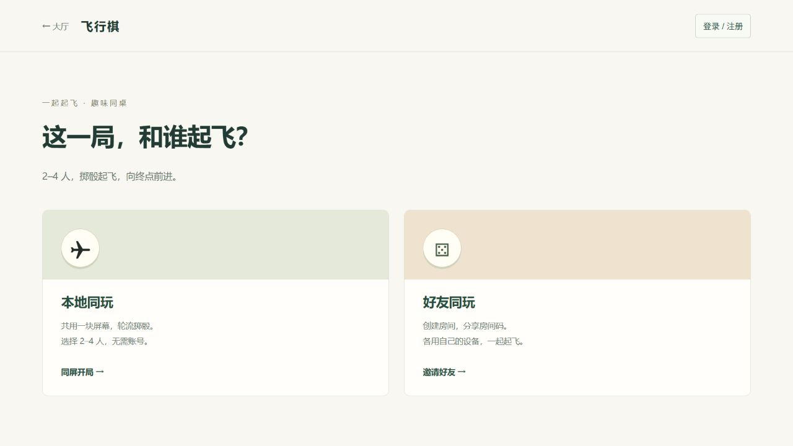

# Ludo Friends · 飞行棋

主站浅色界面，支持 **本地 2–4 人同玩** 和 **账号好友 2–4 人联机**。保留原版彩色棋盘与素材。



## 本地启动

需要 Node.js 24 和 pnpm 10.34.9：

```sh
pnpm install --frozen-lockfile
```

把 `.env.example` 复制为 `.env`，然后：

```sh
pnpm db:migrate
pnpm dev
```

打开 http://localhost:5177 。后端默认只监听本机 3007 端口。安装时需允许 esbuild、better-sqlite3 的构建脚本运行；不需要复制压缩包外的 node_modules，也不应以 --ignore-scripts 作为完成安装的办法。

## 怎么玩

- 本地：选 2 人红黄、2 人蓝绿、3 人或 4 人。点击“掷骰子”或当前玩家面板；有可动飞机时，点飞机或编号按钮。可重新选择人数开始新局。
- 好友：每位玩家注册/登录，创建者选择人数并分享 10 位房间码；大家按预设颜色依次入座，到齐后自动开始。轮到自己时在页面上掷骰，再选飞机。房间、骰子和飞机位置均以服务器为准。
- 离开页面保留座位；刷新后在“继续我的房间”恢复。未开局仅房主可取消。“放弃本局”需要确认，会结束所有人的这一局，不产生胜者，不是只淘汰退出者。
- 同一浏览器普通标签页共用账号；测试多个账号请使用不同浏览器或隐私窗口。

## 本版规则

起飞需掷出 6；掷 6 后走完可再掷；没有飞机可动时自动换手。所有 4 架飞机恰好进入终点为胜，超过终点弹回。

保留上传半成品的飞行通道与最多两次颜色连跳：通道优先，通道后不再继续颜色跳。主路最终停点的对方飞机回基地，起飞点和终点通道不击落。示例红色 pos16 掷2经43格飞至pos30，pos9掷1可连跳至pos18。不是所有地区规则的统一实现。

没有人机、观战、匹配、计时、联机悔棋或积分排行。

## 检查与构建

```sh
pnpm typecheck
pnpm test
pnpm test:classic
pnpm build
```

独立项目 11 项自动测试覆盖认证、2/3/4 人占座、并发/越权/重复请求/版本、重启恢复、确定骰子、无子换手、完成胜利及双模式前端。原引擎的 30 条规则断言保留并通过。详见 docs/COMPLETION.md。

前端产物 apps/web/dist，后端产物 apps/server/dist。双方引擎来自 public/ludo/js/engine.js 和 game-core 的 .cjs 副本，测试核对内容一致；改规则时要同步更新。

## 静态/离线游玩

不运行后端时可打开 apps/web/public/ludo/index.html 玩本地同屏；须完整保留 css、js、img 目录。好友联机需要完整后端，单独上传静态文件到 GitHub Pages 不会获得账号和联机能力。

## 自己部署

见 docs/deployment.md 与 docs/Caddyfile.example。使用自己的 HTTPS 域名、WEB_ORIGIN 和持久数据库。生产环境 HTTP 下账号写入和好友服务关闭。

此独立发行版使用迁移 1，请使用全新数据库，不要直接放入原桌游平台数据库。

包内不含真实账号、数据库、.env、Cookie、生产 SSH 凭据或服务器地址。账号是基础用户名密码登录，没有邮箱验证、找回密码与管理后台。

## 许可

MIT。原素材和代码来源署名见 NOTICE.md，授权文本见 LICENSE 与素材目录中的原始许可。
